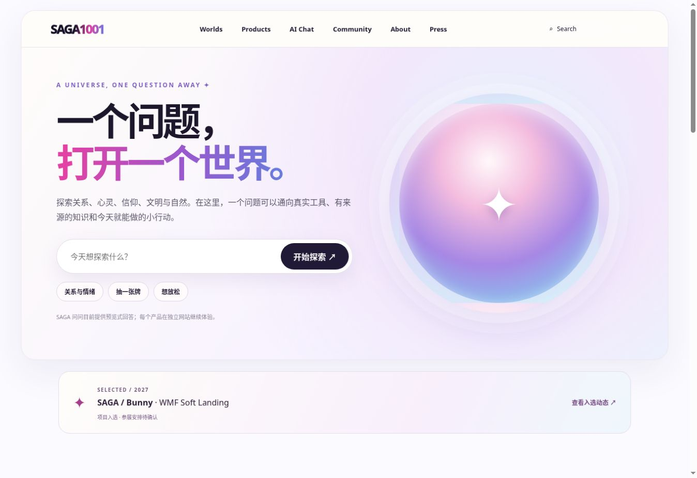
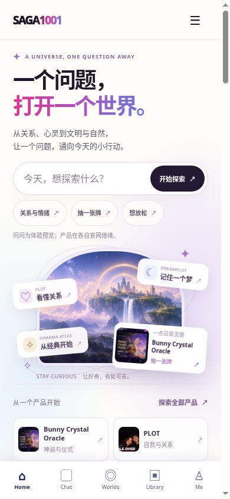
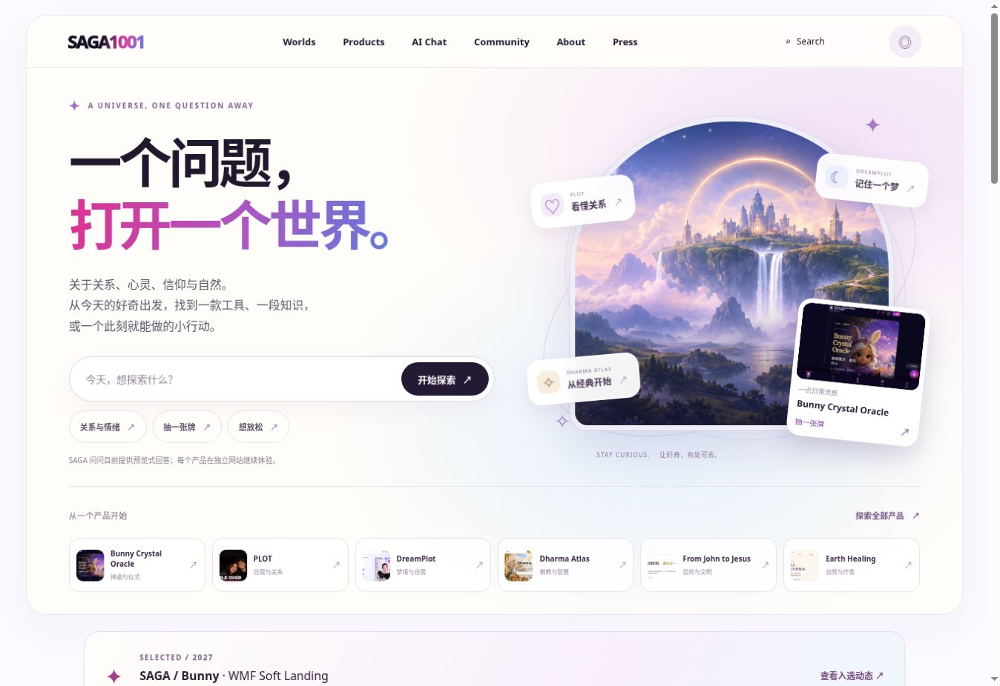

# SAGA1001 首页头图：版本核对与修复

日期：2026-10-21。范围：官网首页 hero、同一首页的静态 HTML、分享预览图和缓存版本。

## 为什么线上只剩下一个圆

基线为 `ed286f7c8dc15e3639c17416360a01f8794ed241`。2026-10-14 的提交 [1db7697](https://github.com/minyajing-rgb/saga1001-world-hall/commit/1db769783123f49916432504725c06a01ebeb5c8) 将首页切换为 V2.1 风格布局，使用 `.v21-orb` CSS 渐变球。线上没有请求原始世界大厅画面，因此问题属于设计落地取舍，不是图片地址失效。

历史材料存在两条视觉方向：

| 材料 | 实际内容 | 本次处理 |
| --- | --- | --- |
| 2026-10 的世界大厅概念蓝图 | 云端城堡、浮岛、瀑布、金色光环，以及八个世界的概念入口 | 复用仓库内原始场景，作为品牌想象画面 |
| V2.1 交互原型和后续界面评审 | 奶油白、大留白、黑色标题、极光渐变，问题入口和抽象球体；原型注明演示路由 | 保留界面语言与提问流程，补足场景、层次与可点击产品入口 |
| 2026-10-14 生产版本 | 简化为左侧问题、右侧空球，产品在下方 | 用有内容的主视觉及六个真实产品入口替换空球 |

本版是对历史方向的重新整合，不宣称逐像素还原某张已批准的最终稿。历史原型中的八世界规划也不等于六款现有产品，二者不能混写成已完成状态。

## 本次结果

- 保留“一个问题，打开一个世界。”与奶油白、黑字、粉紫蓝渐变。
- 主视觉使用既有 `assets/world-hall-hero.jpg`，通过拱形窗口、细轨道与留白形成层次。
- 三个浮层分别连接 PLOT、DreamPlot 与 Dharma Atlas；Bunny 卡片使用真实产品网站截图。
- 六个快捷入口复用现有产品名称、截图与官网地址。独立产品继续在各自网站体验。
- 手机先显示问题，再显示 220px 世界画面和双列产品。输入字号为 16px，主要点击区域至少 44px。
- 保留问问预览说明、既有聊天处理、导航、媒体动态、产品页和英文页；没有接入新的 AI、账号或支付服务。
- 静态首页与 JavaScript 渲染使用同一 `home()` 内容；更新两级脚本缓存版本及首页样式版本。社交预览来自实际页面。

## 截图

### 修复前：实际官网

### 修复后：桌面浏览器

### 修复后：390×844 手机视口

截图来自浏览器实际渲染，不是合成效果图。手机截图包含浏览器滚动条，页面可用内容宽度为 375px。

## 本轮验证

- 浏览器检查 320、390、768、1440 四档视口，均无横向溢出；实际内容宽度分别为 305、375、753、1425px（滚动条占 15px）。
- 390×844：问题表单位于约 y=274–330，画面位于约 y=420–640；首排产品位于底部导航上方。更小屏幕继续通过正常纵向滚动浏览产品。
- 菜单打开/关闭、提交自定义问题、点击“抽一张牌”示例均进入既有流程；回答仍是脚本预览。
- 核对六个产品官网链接、四个浮层官网链接，以及唯一的桌面 Press 入口。
- 禁用 JavaScript 后，头图与六个产品链接仍在静态 HTML 中显示。
- 独立代码复核确认 VM 渲染的 hero 与生成 HTML 一致；`hero.css` 只由中文首页加载。
- 仓库现有 `npm run test:discovery` 已通过：28 个页面、392 项元数据断言、14 组语言对应、28 个 sitemap URL、内部资源链接，以及 4 份 ASO 草稿的字段边界。草稿没有提交到应用商店。

原来的八世界规划、完整产品路由与通用 AI 接入属于后续范围；本次不把这些规划标成已经完成。

## 正式发布核验

[PR #3](https://github.com/minyajing-rgb/saga1001-world-hall/pull/3) 已合并为 `4a2dc2721c5a6cc9c85f06712d3fe79620c6a48d`。[GitHub Pages 发布](https://github.com/minyajing-rgb/saga1001-world-hall/actions/runs/39567293498) 状态为成功。

重新打开 https://saga1001.com/ 后，浏览器确认：新版 hero 存在，旧 `.v21-orb` 不存在；主场景及全部首屏产品图片加载成功，六个产品入口存在；`hero.css` 与入口脚本均为 `20261021-hero-1`，OG 图指向本次实际页面截图。

本节及正式站截图保存在发布核验分支；生产网站代码与 PR #3 的已合并版本一致。
