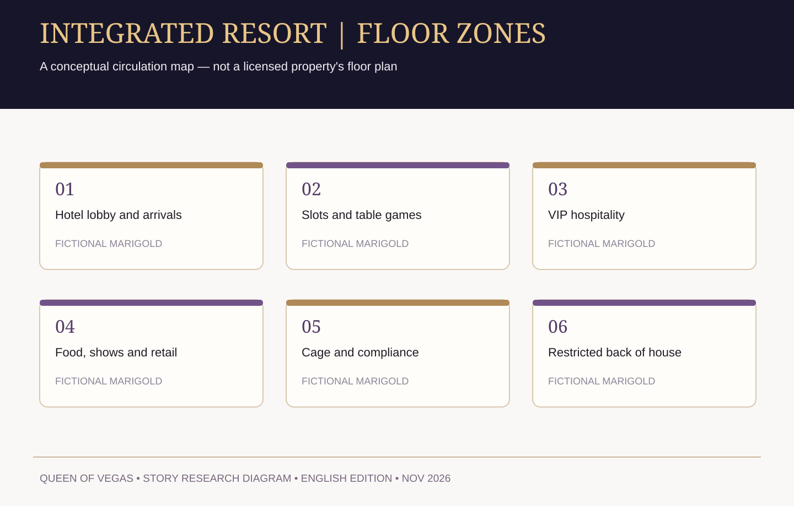
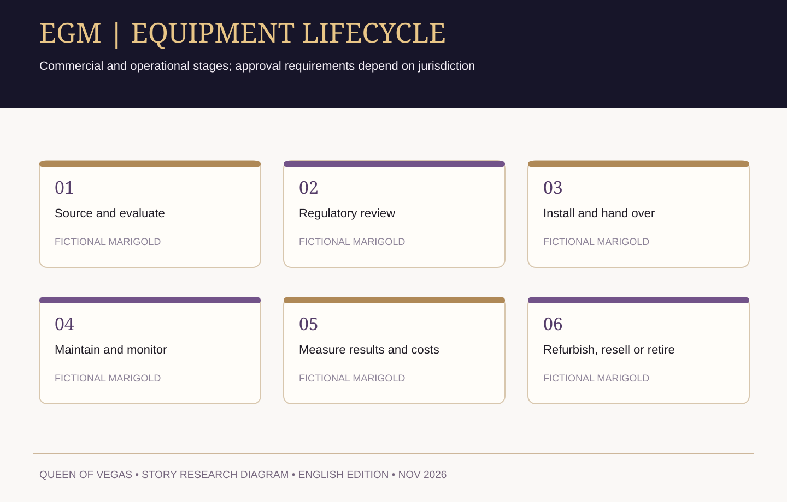
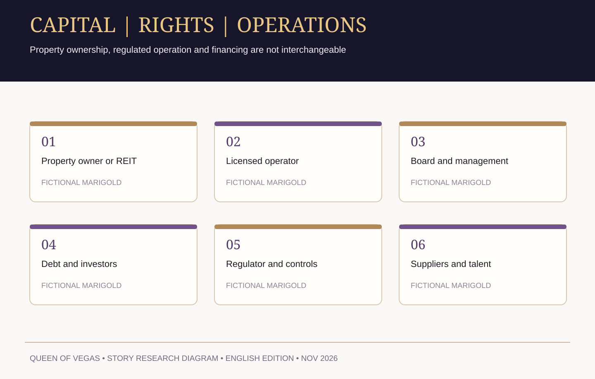
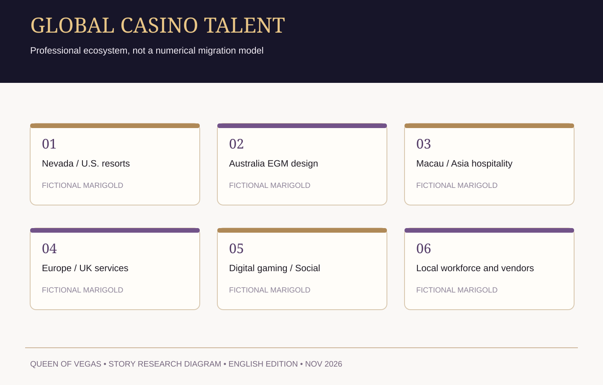
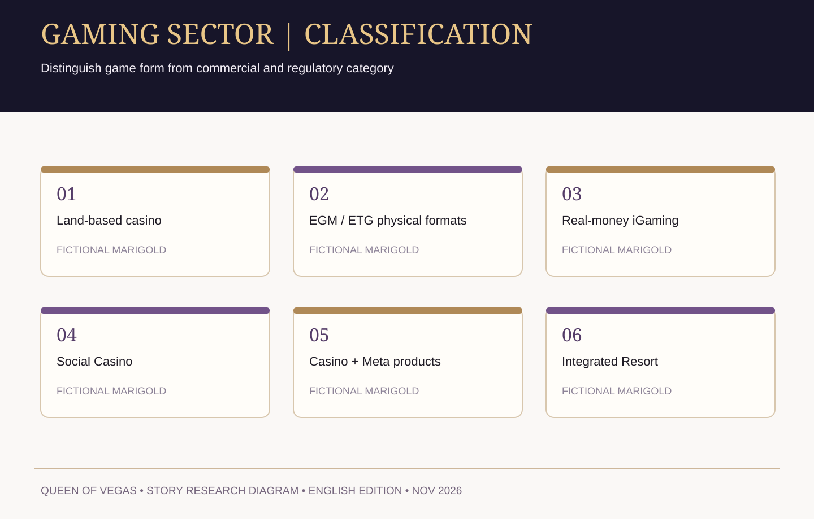

# QUEEN OF VEGAS | V9.1 GitHub downloads

**SAGA1001 Original Fiction — review manuscript, not final retail publication.**

## Complete draft in one file

- [繁體中文：16集故事聖經 + 第一集劇本](Queen_of_Vegas_V9.1_Chinese_Complete.md)
- [English: season-one story bible + pilot screenplay](Queen_of_Vegas_V9.1_English_Complete.md)

## Editable Word downloads

- [繁體中文 Word — full story bible + first episode (text-only)](Queen_of_Vegas_V9.1_Chinese_Text.docx)
- [English Word — complete story bible + pilot (text-only)](Queen_of_Vegas_V9.1_English_Text.docx)

The Word files contain the complete original V9.1 text with headings for easy editing. They deliberately omit images to keep downloads smaller. The Markdown files are the full preserved source text.

## Individual original source files

- [01 — 中文第一季16集故事聖經](01_Story_Bible_ZH-Hant.md)
- [02 — 中文第一集：誰擁有今晚](02_Episode_01_ZH-Hant.md)
- [03 — English story bible](03_Story_Bible_EN.md)
- [04 — English episode-one screenplay](04_Episode_01_EN.md)

## Direct raw text links

- [中文完整稿 RAW](https://raw.githubusercontent.com/minyajing-rgb/saga1001-world-hall/main/stories/queen-of-vegas/v9.1/Queen_of_Vegas_V9.1_Chinese_Complete.md)
- [English complete draft RAW](https://raw.githubusercontent.com/minyajing-rgb/saga1001-world-hall/main/stories/queen-of-vegas/v9.1/Queen_of_Vegas_V9.1_English_Complete.md)

To download: open a file, click **Raw / Download raw file**, or use the raw link above. Markdown files open in VS Code and any text editor; they preserve all original words.

**Status:** Contains full 16-episode story architecture and the pilot script, but not 16 finished shooting scripts or a KDP-submitted novel. Fictional entities and transactions. The folder is public for review at the user's request.

## English-only production diagrams (editorial revision 2026-11-09)

The 2026-11-09 illustrated Word/PDF editorial proof replaces previous cropped portrait strips and Chinese-labeled figures. The diagrams below have **English-only headings** and do not include unverified numerical ROI claims. They are concept/industry research, not a real property floor plan.

### INTEGRATED RESORT | FLOOR ZONES

### EGM | EQUIPMENT LIFECYCLE

### RESORT | REVENUE STREAMS

### CAPITAL | RIGHTS | OPERATIONS

### GLOBAL CASINO TALENT

### GAMING SECTOR | CLASSIFICATION

**Publishing gate:** The V9.1 corpus remains a 16-episode story bible plus pilot screenplay, **not** the completed 16-episode prose novel. Do not mark the Kindle manuscript submitted until a KDP confirmation is observed.
